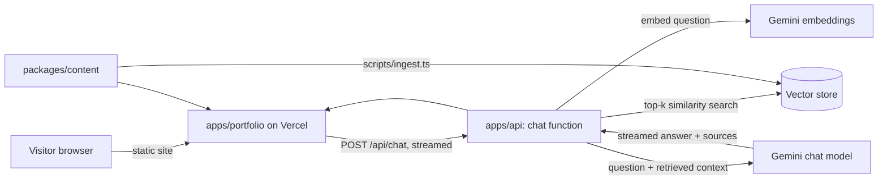

# Chandra Moorthy: AI-enabled Portfolio

A personal portfolio for a full-stack developer with AI integration experience. It is a monorepo containing the website, a serverless backend, and a chatbot that answers questions about Chandra, grounded only in an approved knowledge base (resume, experience, project summaries).

Hosted on Vercel. All services used are free-tier.

> Status legend: **Current** = exists in the repo today. **Planned** = designed here, not built yet.

---

## 1. Goals

| Goal | How |
| --- | --- |
| Professional, animated, responsive site (phone, tablet, desktop) | React + Framer Motion, mobile-first CSS, reduced-motion support |
| Case studies, not just project cards | Separate pages per case study with animated architecture diagrams |
| AI assistant that knows the owner | Retrieval-augmented generation (RAG) over a curated knowledge base |
| Free to run | Vercel Hobby, Gemini free tier, free vector store |
| Safe by default | Answers only from approved content; no secrets or private data in the repo or client |

---

## 2. Repository structure

```
my-portfolio/
├─ apps/
│  ├─ portfolio/        Current. Vite + React + TypeScript site
│  └─ api/              Planned. Vercel serverless functions (chat, contact)
├─ packages/
│  ├─ config/           Current. Shared TypeScript base config
│  ├─ content/          Current. Single source of truth: profile, experience, projects, case studies, FAQ
│  └─ rag/              Current. Chunking, embeddings, retrieval, guardrails, prompt building (unit-tested)
├─ scripts/
│  ├─ ingest.ts         Current. Builds embeddings from packages/content and loads Pinecone
│  └─ eval.ts           Current. Retrieval and guardrail evaluation
├─ .github/workflows/   Planned. CI: typecheck, test, build
├─ .env.example         Current. Names of required variables, no values
└─ README.md
```

**Why `packages/content` is the centre of the design.** The website and the chatbot both read the same data. Update a project once and the page and the bot's knowledge change together, so they cannot contradict each other.

---

## 3. Architecture (Planned)



### Request flow for one chat message

1. The browser sends `{ message, history }` to `/api/chat`.
2. The function validates the input (length, shape), checks the rate limit, and checks the origin.
3. It embeds the question and retrieves the top-k matching chunks from the vector store.
4. If the best similarity is below a threshold, it answers "I don't have that information" and does not call the model.
5. Otherwise it builds a prompt that contains the retrieved context only, and streams the model's answer back.
6. The response includes source labels (for example "Resume", "RentEasify case study") so claims can be traced.

---

## 4. Chatbot design (Planned)

### Scope: what the bot answers

| In scope | Out of scope |
| --- | --- |
| Chandra's experience, role, skills, education, availability | General programming help, tutorials, or unrelated trivia |
| What Chandra built in each project and how it works | Anything not in the knowledge base (it says so instead of guessing) |
| Why a technology was used in a project (for example "how was Pinecone used?") | Salary, phone number, or other private details |

Stack questions are answered in the context of the projects ("what did Chandra use Node.js for?"), not as general technology lessons.

The project is strictly two parts: the **UI** (`apps/portfolio`) and the **backend** (`apps/api` plus `packages/rag`). There is no admin application.

### Knowledge base ("memory")

| Source | Content | Rule |
| --- | --- | --- |
| Resume | Experience, skills, education, dates | Phone number excluded |
| Profile | Summary, location, availability, relocation and visa preference | Owner-approved wording |
| Projects and case studies | Problem, role, stack, public live links | Public, non-confidential only |
| FAQ | Anticipated recruiter questions | Written and reviewed by the owner |

**Updating the knowledge base:** there is deliberately no admin app. The owner edits the structured files in `packages/content` (the resume PDF is an input to review, not an automatic source) and runs `npm run ingest`, which re-embeds and upserts to Pinecone. This keeps the public attack surface to the chat endpoint only.

Live project details are curated summaries of each product, not scraped pages. Employer-owned details need approval before they go into the knowledge base. Nothing in the knowledge base should be something that cannot appear on the public site, because users can ask the bot to repeat it.

### Models and storage

| Concern | Choice | Notes |
| --- | --- | --- |
| LLM and embeddings | Google Gemini via a free AI Studio key | OpenAI's API has no standing free tier, so Gemini is the realistic free option. Pin current model names at build time. |
| Vector store | Pinecone (free tier) | Decided. Matches existing resume experience. The corpus is small (tens to low hundreds of chunks), so one index with a single namespace is enough. |
| Rate limiting | Upstash Redis free, or Vercel's built-in protections | Per-IP sliding window |

Free-tier limits and terms change. Verify them before relying on them. Free-tier prompts can be used by the provider to improve its products, which is acceptable here only because the knowledge base is public content.

### Guardrails

- Answer only from retrieved context. Say "I don't know" otherwise. Refuse requests for salary, private data, or anything outside the knowledge base.
- Treat user text as data, never as instructions. The system prompt is fixed on the server and the client cannot change it.
- Cap message length and conversation history. Rate-limit per IP. Set a daily request budget so a free quota cannot be drained.
- API keys exist only in server-side environment variables. Nothing sensitive reaches the browser.
- No conversation storage by default. If analytics are added, store no personal data.
- A small evaluation set of questions and expected answers runs in CI to catch regressions and hallucinations.

---

## 5. Backend plan (apps/api, Planned)

| Endpoint | Purpose |
| --- | --- |
| `POST /api/chat` | RAG chat, streamed response |
| `POST /api/contact` | v2: contact form (validation, honeypot, rate limit, email provider). v1 uses a `mailto:` link. |
| `GET /api/health` | Uptime check |

Engineering principles applied:

- **Separation of concerns:** `apps/api` handlers stay thin; logic lives in `packages/rag` and is testable without a server.
- **Input validation at the boundary** with a schema library, and consistent error responses.
- **Idempotent ingestion:** re-running `scripts/ingest.ts` upserts by stable chunk IDs and never duplicates.
- **Complexity:** retrieval is top-k cosine similarity. With hundreds of chunks this is trivial even in memory. Chunk size and overlap are tuned against the evaluation set.
- **Fail safe:** timeouts, a friendly fallback message, and no stack traces in responses.

---

## 6. Hosting on Vercel (Planned)

| Project | Root directory | Output |
| --- | --- | --- |
| portfolio | `apps/portfolio` | Static build (`dist`) |
| api | `apps/api` | Serverless functions |

The portfolio project proxies `/api/*` to the API project with a rewrite, so the browser sees one origin and no CORS configuration is needed. If this proves awkward, the fallback is a single Vercel project with functions in the app's own `api/` folder.

Environment variables (names only; values live in Vercel, never in git):

```
GEMINI_API_KEY=
VECTOR_STORE_URL=          # if Pinecone or Upstash
VECTOR_STORE_TOKEN=
RATE_LIMIT_REDIS_URL=
RATE_LIMIT_REDIS_TOKEN=
ALLOWED_ORIGIN=
```

---

## 7. Roadmap and branching

Each phase is its own branch, merged to `main` by pull request with small commits.

| Phase | Branch | Scope |
| --- | --- | --- |
| 0 | `chore/monorepo-structure` | Done. Monorepo, shared config |
| 1 | `feat/content-data` | `packages/content`: resume, projects, case studies as typed data. Case studies stay unapproved until the owner signs off |
| 2 | `feat/site-redesign` | New layout, motion, case-study pages, mobile and tablet polish |
| 3 | `feat/rag-core` | Done. `packages/rag` with tests, an evaluation set, and the ingest script |
| 4 | `feat/chat-api` | `apps/api` chat endpoint, guardrails, rate limit |
| 5 | `feat/chat-widget` | Streaming chat UI, suggested questions, accessibility |
| 6 | `chore/ci-deploy` | GitHub Actions, Vercel projects, environment setup |
| 7 | `feat/contact-api` | v2 contact endpoint |

---

## 8. Run locally

Requires Node.js 22 or newer. From the repository root:

```bash
npm install
npm run dev          # portfolio site
npm run typecheck
npm run build
npm run preview
```

### Chatbot knowledge base

```bash
npm test                       # unit tests, offline
npm run eval                   # offline guardrail and pipeline check, no keys
npm run eval -- --gemini       # real recall check (needs GEMINI_API_KEY in .env)
npm run check:pinecone         # verify index name, dimension, metric and record counts
npm run ingest -- --dry-run    # show what would be indexed
npm run ingest                 # embed and upsert to Pinecone (idempotent)
npm run ingest -- --reset      # wipe the namespace, then re-index
```

Copy `.env.example` to `.env` and fill in your own keys first. Create the Pinecone index beforehand: serverless, cosine metric, dimension 768.

---

## 9. Content and publishing rules

- Verify every contribution, technology, title and link.
- Do not commit a resume showing a personal phone number to a public repository.
- Ask permission before describing employer-owned products or showing screenshots. Never publish credentials, customer data, private architecture or confidential metrics.
- Only add metrics that can be substantiated.
- Test keyboard navigation, reduced motion, phone and tablet layouts, contrast and external links.
