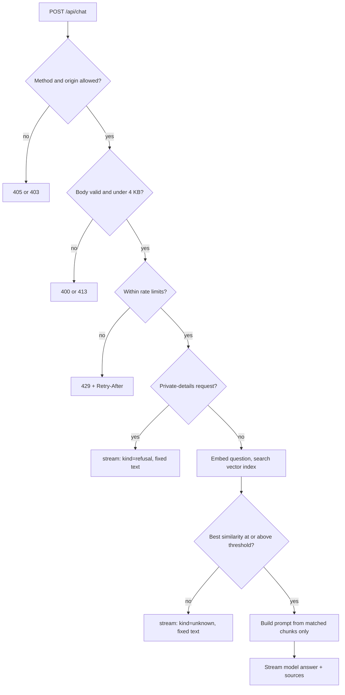

# @my-portfolio/api: chat backend

The serverless backend behind the portfolio's "Ask about Chandra Moorthy" chatbot. It answers questions using only the approved knowledge base (resume, experience, project summaries), refuses private or off-topic requests, and streams the answer back with sources.

Deployed as Vercel Functions. All services run on free tiers.

> Status legend: **Planned** = designed here, not built yet. This README is written first so the implementation can be reviewed against it.

---

## 1. Responsibilities

| This service does | This service does not do |
| --- | --- |
| Validate and bound every request | Store conversations or visitor data |
| Rate-limit per visitor and globally | Authenticate users (the endpoint is public by design) |
| Refuse private-detail requests before any AI call | Serve the website (that is `apps/portfolio`) |
| Retrieve from the vector index and answer from it only | Accept new knowledge at runtime (re-index with `npm run ingest`) |
| Stream the answer with source labels | Write to the vector index |

---

## 2. HTTP contract

### `POST /api/chat`

Request (`Content-Type: application/json`, body at most 4 KB):

```json
{
  "message": "What AI work has Chandra Moorthy done?",
  "history": [
    { "role": "user", "text": "Hi" },
    { "role": "assistant", "text": "Hello, ask me about Chandra Moorthy's work." }
  ]
}
```

| Field | Rule |
| --- | --- |
| `message` | Required string, 1 to 300 characters after trimming |
| `history` | Optional array of at most 6 `{ role: "user" \| "assistant", text: string }`, each text at most 500 characters. Only the last 6 are used. |

Success: `200`, `Content-Type: text/event-stream`. Every successful reply uses the same event shape, including refusals, so the client has one code path:

```
event: meta
data: {"kind":"answer","sources":["RentEasify","Skills"]}

event: token
data: {"text":"In RentEasify, "}

event: token
data: {"text":"Chandra Moorthy built ..."}

event: done
data: {}
```

| `kind` | Meaning | AI model called? |
| --- | --- | --- |
| `answer` | Answered from retrieved context | Yes |
| `unknown` | Nothing in the knowledge base cleared the similarity threshold | No |
| `refusal` | A private-details request (phone, salary, address, ...) | No |

If the model fails after streaming has started, the stream ends with `event: error` and `data: {"code":"upstream_error","message":"..."}`.

Errors before streaming starts are plain JSON, `{ "error": { "code": "...", "message": "..." } }`:

| Status | `code` | Cause |
| --- | --- | --- |
| 400 | `invalid_request` | Bad JSON, wrong shape, empty or over-long message |
| 403 | `forbidden_origin` | `Origin` header is not on the allow-list |
| 405 | `method_not_allowed` | Anything except `POST` or `OPTIONS` |
| 413 | `body_too_large` | Body over 4 KB |
| 429 | `rate_limited` | Visitor or daily limit reached. `Retry-After` header is set. |
| 502 | `upstream_error` | Embedding, vector search or model call failed before streaming |
| 500 | `internal` | Unexpected error. No stack trace is ever returned. |

### `OPTIONS /api/chat`

CORS preflight. `204` with CORS headers when the origin is allowed.

### `GET /api/health`

`200 {"ok":true}`. No secrets, no upstream calls.

---

## 3. Request flow



Steps are ordered so the cheapest checks run first and requests are stopped before they use any paid or quota-limited service.

---

## 4. Code layout (Planned)

```
apps/api/
├─ api/
│  ├─ chat.ts        Vercel entry: default export { fetch }, wires real dependencies
│  └─ health.ts
├─ src/
│  ├─ chat.ts        handleChat(request, deps): the whole flow, pure and testable
│  ├─ config.ts      loadConfig(env): parses and validates settings
│  ├─ http.ts        JSON errors, CORS headers, SSE encoding, client IP
│  ├─ limiter.ts     RateLimiter interface, in-memory limiter, Upstash limiter
│  ├─ generator.ts   Generator interface (Gemini adapter lives in packages/rag)
│  ├─ deps.ts        Composition root: builds real dependencies from env
│  └─ *.test.ts      Tests with fake dependencies
└─ README.md
```

Design rule: **`handleChat` takes a web-standard `Request` and returns a `Response`, and receives every external service as an argument.** Nothing in it reads environment variables or touches the network directly. That is what makes it testable without a server (section 6).

---

## 5. Configuration

Read once at start-up by `loadConfig`. Names only here; values live in `.env` locally and in Vercel project settings.

| Variable | Required | Purpose |
| --- | --- | --- |
| `GEMINI_API_KEY` | yes | Embeddings and answers |
| `GEMINI_CHAT_MODEL` | yes | Model used for answers. Copy the current free Flash model name from Google AI Studio. Deliberately has no default, because model names change. |
| `GEMINI_EMBEDDING_MODEL` | no | Defaults to `gemini-embedding-001` |
| `EMBEDDING_DIMENSIONS` | no | Must equal the index dimension. Default 768 |
| `PINECONE_API_KEY`, `PINECONE_INDEX` | yes | Vector search. `PINECONE_INDEX` is the index name, not its URL |
| `PINECONE_NAMESPACE` | no | Default `portfolio` |
| `UPSTASH_REDIS_REST_URL`, `UPSTASH_REDIS_REST_TOKEN` | production | Shared rate-limit counters |
| `ALLOWED_ORIGINS` | production | Comma-separated site origins, for example `https://your-site.vercel.app` |
| `RETRIEVAL_THRESHOLD` | no | Default 0.60. Tune with `npm run eval -- --gemini` |
| `RATE_LIMIT_PER_MINUTE` | no | Per visitor. Default 10 |
| `RATE_LIMIT_PER_DAY` | no | Per visitor. Default 40 |
| `GLOBAL_DAILY_LIMIT` | no | All visitors combined, protects the free quota. Default 500 |

Missing required settings fail fast with a message naming the variable. Secrets are only ever read server-side and are never logged.

---

## 6. Testing without a server

No HTTP server, deployment or network is needed to test this backend. There are three levels.

### Level 1: automated tests (offline, no keys)

`handleChat` is a function from `Request` to `Response`, so tests call it directly with fake dependencies:

```ts
const res = await handleChat(
  new Request("https://test.local/api/chat", {
    method: "POST",
    headers: { origin: "https://site.example", "content-type": "application/json" },
    body: JSON.stringify({ message: "What did they build in RentEasify?" }),
  }),
  fakeDeps
);
expect(res.status).toBe(200);
```

Fakes: an in-memory vector store, the offline lexical embedder, a scripted generator, and an in-memory rate limiter. The tests cover every status code in section 2, every `kind`, the CORS rules, rate limits, and mid-stream failure.

```bash
npm test
```

### Level 2: local command line (optional keys)

Runs the same `handleChat` in-process and prints the streamed reply:

```bash
npm run chat -- "What AI work has Chandra Moorthy done?"            # offline: no keys, echoes matched context
npm run chat -- --live "What AI work has Chandra Moorthy done?"     # real Gemini + Pinecone, local rate limiter
```

`--live` reads your `.env` and needs a populated Pinecone index (`npm run ingest`).

### Level 3: deployed smoke test

After deployment, from any terminal:

```bash
curl -N -X POST https://YOUR-API-URL/api/chat \
  -H "Origin: https://YOUR-SITE-URL" -H "Content-Type: application/json" \
  -d '{"message":"Is Chandra Moorthy open to relocation?"}'
```

A small local HTTP server is deliberately not part of this phase. It is only needed when the website's chat widget is built, and can be added then.

---

## 7. Security notes

- **Public endpoint, so assume abuse.** Rate limiting is per visitor and global, and the global cap stops a flood from exhausting the free quota.
- **Origin allow-list.** Browsers send `Origin`; requests from other sites are rejected. This stops other websites embedding the bot. It is not authentication, because non-browser clients can set any header.
- **Visitor IP** is read from Vercel's forwarded-IP header and used only as a rate-limit key.
- **Prompt injection.** User text and retrieved text are delimited as data, delimiter tags are stripped, and the system prompt is fixed on the server.
- **No private data in the index.** Only content already public on the site is indexed. The phone number is excluded, and private-detail questions are refused by pattern before any retrieval.
- **No storage.** Question text is not logged or stored. Logs record status, reason and latency only.
- **Errors never leak** stack traces or upstream messages.

---

## 8. Deployment (Planned)

A separate Vercel project from the website:

| Setting | Value |
| --- | --- |
| Root Directory | `apps/api` |
| Include source files outside the Root Directory | on (the API imports `packages/rag` and `packages/content`) |
| Environment variables | Section 5, in Vercel project settings |

The website reaches it through a rewrite of `/api/*` to the API project, so the browser sees a single origin.

Open items to verify at deployment time, because they cannot be proven locally:

1. That Vercel compiles the workspace TypeScript packages imported by the functions. Fallback: bundle the handler with esbuild before deploy.
2. That the `{ fetch }` default-export handler and streaming behave as expected on the Node.js runtime.
3. That the chosen Gemini chat model is available on the free tier.

---

## 9. Troubleshooting

| Symptom | Likely cause |
| --- | --- |
| `403 forbidden_origin` in the browser | Your site's exact origin is missing from `ALLOWED_ORIGINS` (scheme and host must match, no trailing slash) |
| `429 rate_limited` while testing | Per-minute limit reached. Wait for `Retry-After` seconds |
| Every answer is `kind: unknown` | Index is empty or in another namespace. Run `npm run check:pinecone`, then `npm run ingest -- --reset` |
| Startup error naming a variable | A required setting is missing. Check `.env` or Vercel settings |
| `502 upstream_error` | Gemini or Pinecone rejected the call: wrong key, wrong model name, or free quota used up |
